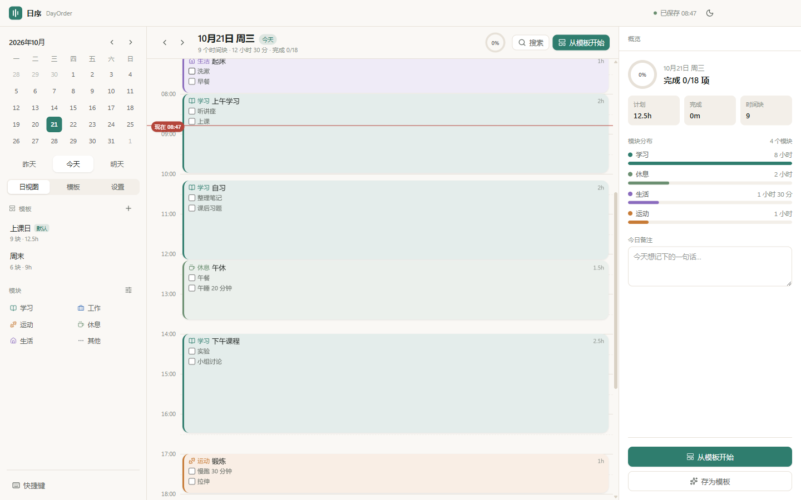
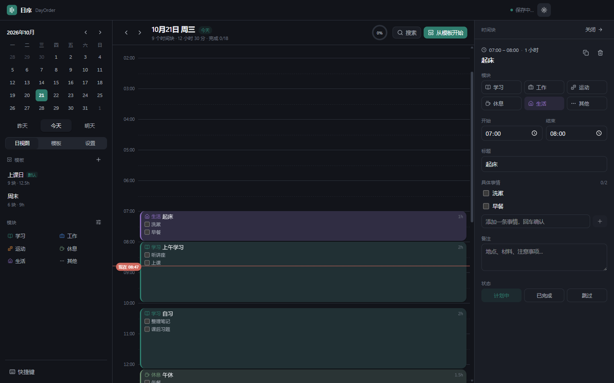
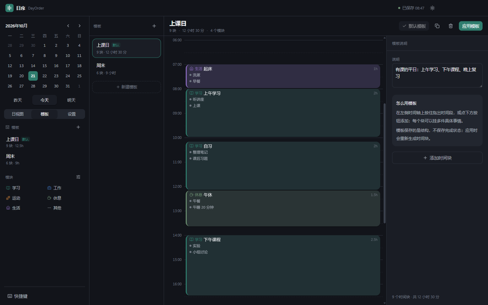

# 日序 DayOrder

[](https://github.com/xiaoli0126/dayorder/actions/workflows/ci.yml)
[](LICENSE)
[](https://github.com/xiaoli0126/dayorder/releases)

一个纯本地、零账号、双击即用的「时间轴式」一天规划器。

一天的骨架是 **时间段 + 模块 + 具体事情**：

```
08:00 – 10:00   学习   · 听讲座   · 上课
```

把这副骨架存成**模板**，第二天选一下模板，30 秒得到一天，再按当天情况微调。



## 功能

- **日视图时间轴**：00–24 点纵向时间轴，5 分钟吸附，空白处拖拽新建，拖动改时间，拖边改时长。
- **模块**：学习 / 工作 / 运动 / 休息 / 生活 / 其他，颜色、图标、默认时长可改；统计按模块汇总。
- **时间块与事项**：一个块挂多件具体事情，可勾选、可备注、可标记「计划中 / 已完成 / 跳过」。
- **重叠分栏**：同一时段多个块自动并排，不遮挡。
- **模板**：新建 / 编辑 / 复制 / 删除 / 设为默认；应用到某天时可「仅补空缺」或「覆盖当天」，结果可撤销。
- **当天存为模板**：一键把今天的时间块结构保存下来。
- **自动保存与备份**：500ms 防抖落盘，原子写入；启动时滚动备份（最近 20 份 + 每日 1 份），可导出 / 导入 JSON、恢复备份。
- **撤销重做**：50 步，覆盖拖拽、删除、应用模板、事项编辑。
- **亮暗主题**：暖纸 / 墨夜，跟随系统；4 个强调色。
- **快捷键**：`←/→` 换日、`T` 今天、`N` 新建、`Delete` 删除、`Ctrl+Z` 撤销、`Ctrl+F` 搜索。
- **搜索**：跨天搜标题、具体事情、备注，回车跳转定位。

| 暗色 | 模板编辑 |
| --- | --- |
|  |  |

## 下载

从 [Releases](https://github.com/xiaoli0126/dayorder/releases) 获取 Windows x64 版本：

- `DayOrder-0.1.0-x64.exe`：安装版，可选安装目录，创建桌面与开始菜单快捷方式。
- `DayOrder-0.1.0-portable.exe`：免安装便携版，数据写在 exe 同级的 `data/` 目录。

安装包未签名，首次运行如遇 SmartScreen，点「更多信息 → 仍要运行」。

## 快速开始

需要 Node.js ≥ 22。首次安装依赖会下载 Electron 二进制。

```bash
npm install
npm run dev        # 开发模式（HMR）
npm run build      # 类型检查 + 三端构建
npm run dist       # 打包 Windows 安装包 + 便携版
```

产物在 `dist/`：`DayOrder-<version>-x64.exe`（NSIS 安装包）与 `DayOrder-<version>-portable.exe`（免安装）。

### 国内网络

Electron 二进制与 NSIS 工具默认从 GitHub 下载。本项目在 `.npmrc` 里配置了 Electron 镜像；打包时再补一个环境变量：

```powershell
$env:ELECTRON_MIRROR = "https://npmmirror.com/mirrors/electron/"
$env:ELECTRON_BUILDER_BINARIES_MIRROR = "https://npmmirror.com/mirrors/electron-builder-binaries/"
npm run dist
```

## 数据与备份

- 默认位置：`%APPDATA%\dayorder\data\planner.json`（设置页可一键打开目录）。
- 便携版：数据写在 exe 同级 `data\` 目录（检测 `PORTABLE_EXECUTABLE_DIR`）。
- 备份：`data\backups\`，启动时生成；保留最近 20 份 + 每日 1 份，最多 50 份。
- 恢复路径：主文件损坏 → 移入 `backups\corrupt-*.json` 留档 → 自动尝试最新备份 → 仍失败则创建空白文档并提示。
- 数据是单文件 JSON，可自行复制、比对、版本管理。

## 工程结构

```
src/
├─ main/        Electron 主进程：窗口、IPC、存储、备份
├─ preload/     contextBridge 暴露的 window.api
├─ shared/      类型、zod 校验与迁移、时间/布局/模板/统计纯函数
└─ renderer/    React UI（时间轴、检查器、模板、设置）
tests/
├─ unit/        Vitest：时间、分栏、模板、校验、统计
└─ e2e/         Playwright（CDP 驱动 Electron）：模板、持久化、拖拽建块
```

## 测试与质量闸门

```bash
npm run typecheck
npm run lint
npm test
npm run test:e2e     # 会真实启动应用，需要构建产物（npm run build）
```

- 单元测试 29 项；E2E 4 条主流程（应用模板 / 重启持久化 / 新建块与事项 / 拖拽建块 / 模板编辑应用）。
- E2E 通过 DevTools 协议连接应用，截图输出到 `test-results/`。

## 实现说明

- Electron 44 + electron-vite 6 + React 19 + TypeScript 5.9 + Tailwind CSS 4 + Zustand + zod。
- 时间用「当天分钟数」整数存储，日期用本地 `YYYY-MM-DD`，避免时区漂移。
- 文档带 `schemaVersion`，读取容错：字段缺失回退默认、悬空模块引用自动迁移、未来版本进入只读。
- 渲染进程无 Node 权限（`sandbox: true` + `contextIsolation: true`），所有文件操作走 IPC 白名单。
- 未签名安装包：Windows 首次运行会提示 SmartScreen，点「更多信息 → 仍要运行」即可。

## 已知限制（v1）

- 时间块不支持跨零点（自动夹到 24:00）。
- 没有云同步、通知提醒、周视图、重复块；这些在路线图里。
- 未做代码签名与自动更新。
- 仅中文界面。

## 开发环境备注

本仓库在受限沙箱里开发时遇到过几个环境问题，脚本里已处理，普通机器无需关心：

- `ELECTRON_RUN_AS_NODE=1` 会让 Electron 以 Node 模式启动：`scripts/clean-electron-env.cjs` 在 dev / e2e 时清除它。
- Vite 在 Windows 会调用 `net use` 探测网络盘，受限进程里 `spawn EPERM`：`scripts/patch-net-use.cjs` 让它走 `fs.realpathSync.native` 回退。
- Electron 的多进程 IPC 依赖命名管道，必须在无沙箱环境下启动；安装依赖时也需要允许安装脚本运行。

## License

[MIT](LICENSE) © 2026 ljj
